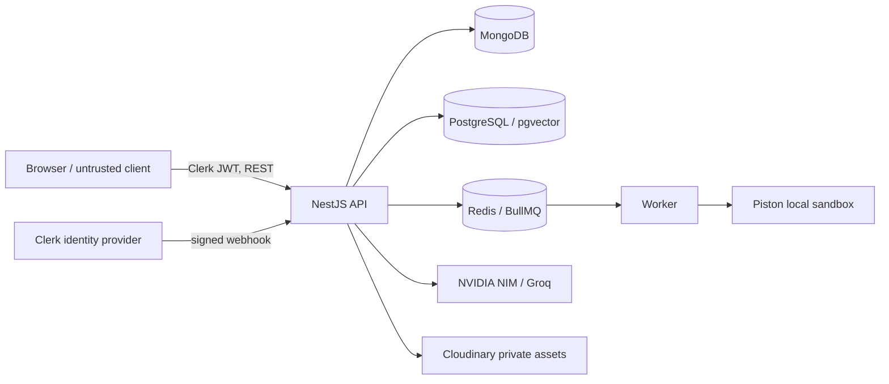

# PrepAI backend threat model

## Scope and assumptions

This STRIDE review covers the React SPA, NestJS/Fastify API, Clerk
authentication and webhooks, MongoDB, PostgreSQL/pgvector, Redis/BullMQ,
Piston, Podman, and external AI/file providers. It reflects the repository as
of 2026-11-03. It is a design review, not a penetration test or certification.

The local stack is for development. Production hosting and managed database
providers are not fully selected. PostgreSQL ownership predicates are enforced
in application code; RLS rollout is still pending staging validation. The
local Piston container is privileged and must not serve public multi-tenant
execution.

## Data and trust boundaries

The browser, webhook network, submitted PDF/code, Redis job delivery, and
provider responses are untrusted inputs. API and worker credentials are
privileged trust boundaries. Never treat a queue payload as proof of user
ownership.

## STRIDE risks and controls

| STRIDE                 | Threat                                                               | Current controls                                                                                                       | Residual risk / action                                                                                               |
| ---------------------- | -------------------------------------------------------------------- | ---------------------------------------------------------------------------------------------------------------------- | -------------------------------------------------------------------------------------------------------------------- |
| Spoofing               | Forged or expired browser identity                                   | Clerk JWT guard verifies authenticated requests; ownership uses the verified subject                                   | Verify issuer/audience configuration and auth behavior in staging; add abuse/rate limits before broad public traffic |
| Spoofing               | Forged Clerk lifecycle webhook                                       | Svix signature verification is required before user mutation                                                           | Rotate webhook secret on suspected exposure; alert on signature failures when metrics are deployed                   |
| Spoofing               | Worker trusts a job-supplied owner                                   | Coding worker reloads persisted owner; PDF worker reloads owned metadata                                               | Audit each new queue consumer and test tampered/stale IDs                                                            |
| Tampering              | User changes another user's record or links child rows across owners | Service predicates include owner; IDs are not treated as authorization                                                 | PostgreSQL RLS is only implemented/tested in a disposable harness; staging role rollout remains open                 |
| Tampering              | Malformed uploads, provider output, or database input                | DTO validation, PDF size/type/page bounds, vector dimension checks, schema validation, Prisma parameterization         | Continue fuzzing parsers and provider response paths; scanned PDFs are rejected rather than OCR'd                    |
| Tampering              | Untrusted PDF instructions influence generated questions             | Retrieved text is marked untrusted and generated citations are checked against retrieved chunks                        | Evaluate prompt injection and citation quality with adversarial fixtures before production                           |
| Repudiation            | User denies a write or webhook-triggered change                      | Request IDs and structured Pino logs; webhook verification                                                             | No append-only audit log or end-to-end correlation metrics yet; design before payments/role changes                  |
| Repudiation            | Worker retry creates duplicate answer/execution                      | Durable rows, stable identities, BullMQ IDs, conditional state transitions                                             | Shared idempotency scope/replay policy is still open; test duplicate requests at API boundaries                      |
| Information disclosure | IDOR exposes profiles, sessions, answers, or PDF chunks              | Owner-scoped service predicates, authenticated routes, PDF retrieval filters, private Cloudinary assets                | RLS not active in normal DB; run restricted-role staging tests before multi-tenant production                        |
| Information disclosure | Secrets or user content appears in logs or browser bundle            | Secret values remain server-side; Piston response/output caps; AI prompt redacts selected PII patterns                 | PII redaction is partial; review every new log path and ensure `CLERK_SECRET_KEY`/provider keys never use `VITE_*`   |
| Information disclosure | Piston/API exposed beyond host                                       | Local Piston binds `127.0.0.1:2000`; code execution is disabled by default in production                               | Local container is privileged and shares host kernel; use reviewed VM-backed isolation before public execution       |
| Denial of service      | Large requests, expensive AI calls, queue floods, or runaway code    | Request/body bounds, role-based AI quotas, queue concurrency, retry caps, Piston CPU/memory/time/process/output limits | No complete distributed API rate limiter or production metrics/alerts; configure before launch                       |
| Denial of service      | Database or Redis exhaustion                                         | Readiness endpoints, bounded workers, connection pools and provider health checks                                      | Capacity/SLO numbers are unmeasured targets; load-test and configure provider alerts                                 |
| Elevation of privilege | User reaches admin operations                                        | Role guard and admin metadata on privileged routes                                                                     | Review role synchronization/webhook transitions and add audit records before implementing payments                   |
| Elevation of privilege | Runtime DB credential bypasses RLS                                   | Restricted API/worker roles and policy SQL exist for isolated tests                                                    | Local compose uses `postgres`; staging must use non-owner, non-superuser, non-bypass roles before relying on RLS     |
| Elevation of privilege | Escape from code sandbox                                             | Per-job Isolate limits and aggregate Podman caps in local setup                                                        | `--privileged` is required by current WSL2 cgroup bootstrap; this is not a production tenant boundary                |

## Required operating controls

- Keep development credentials and local container ports out of production.
- Store production credentials in a managed secret store; rotate exposed
  Clerk, database, Cloudinary, AI, and webhook secrets.
- Keep PostgreSQL schema-owner credentials out of API and worker processes.
- Keep Piston loopback-only in development and disabled for public production
  until an independent isolation service passes security review.
- Configure provider backups, restore drills, TLS, rate limiting, monitoring,
  and incident alerting before public production. The repo documents target
  controls; it does not prove those provider settings are active.
- Apply database migrations and RLS policies in a dedicated staging database
  with disposable/test data before production rollout.

## Verification cadence

Review this model when adding an externally reachable route, database model,
queue consumer, provider credential, or privilege transition. Each risk control
should have a corresponding test or operator check. Run the isolated ownership
suite with `pnpm test:database:isolation`; run the server gate with
`pnpm gate -- --stack server --level full`. A passing suite does not replace
staging deployment review, provider configuration checks, or penetration
testing.

## Open risks

- PostgreSQL RLS is not enabled on normal development or production databases.
- Piston remains a privileged local container and cannot safely process public
  untrusted code in production.
- Backup providers, retention policies, production secret storage, monitoring,
  and distributed request rate limiting are not verified/configured here.
- Current PII redaction recognizes selected formats; it is not full
  anonymization.
