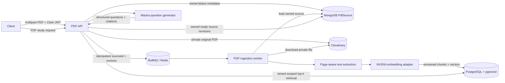

# PDF ingestion and RAG design

## Status

Implemented v1 baseline. The companion
[implementation plan](../plans/2026-11-03-pdf-ingestion-rag.md) tracks code and
verification. Production rollout still requires the PostgreSQL schema/RLS
scripts, provider credentials, and runtime-role integration verification.

## Intent

Let an authenticated user upload study PDFs, wait for them to become searchable,
and generate theory-practice questions grounded in those PDFs with page
citations. Ingestion and question generation must remain asynchronous where
they call storage, parsing, embedding, or language-model providers.

## Existing project decisions and constraints

- [ADR-0001](../../adr/0001-polyglot-persistence.md) places `PdfSource`
  metadata in MongoDB and selects PostgreSQL for relational data and vectors.
- [ADR-0003](../../adr/0003-pgvector-for-rag.md) selects pgvector rather than
  another vector database. It proposes 1024-dimension NVIDIA embeddings and an
  IVFFlat cosine index.
- [ADR-0004](../../adr/0004-bullmq-for-async-jobs.md) reserves the
  `pdf-ingest-queue` with concurrency 2 and five attempts.
- `@fastify/multipart` is registered with a configurable 10 MiB per-file
  limit. PDF upload, persistence, workers, and study endpoints are implemented
  in `server/src/modules/pdf/`.
- PostgreSQL tenant tables use transaction-local RLS identity. PDF chunks are
  covered by `server/prisma/rls/002-pdf-rag.sql`; the disposable restricted-role
  test harness applies and exercises that policy.
- Chunk size/overlap use whitespace-separated pieces, not model-token counts.
  Top 8 and the 0.7 similarity floor are configurable initial values, not
  retrieval-quality-validated thresholds.

## Goals

- Persist file metadata and ownership, store original PDF bytes privately, and
  expose durable ingestion status.
- Extract page-aware text, split it into bounded chunks, embed it, and persist
  versioned chunks in PostgreSQL/pgvector.
- Retrieve only chunks belonging to the authenticated owner and selected,
  ready PDF revisions.
- Generate structured practice questions from retrieved text and return
  source PDF/page citations that point to the chunks actually supplied to the
  model.
- Make upload, ingestion, re-ingestion, retries, and deletion idempotent and
  recoverable across API/worker restarts.
- Keep provider calls outside database transactions and keep user identity
  derived from verified Clerk auth or persisted source metadata.

## Non-goals for v1

- OCR for scanned or image-only PDFs.
- A general chat-over-documents product, arbitrary file formats, public sharing,
  cross-user document sharing, or vector search across all users.
- Replacing Cloudinary, MongoDB, PostgreSQL, BullMQ, or the existing Mastra
  provider setup.
- Premium cross-encoder reranking. It can be evaluated after retrieval quality
  has a labeled baseline.
- Claiming the PDF tables are protected by RLS before their migration, policies,
  role grants, and real database tests are implemented.

## Approaches

### A. Preserve the accepted polyglot architecture — recommended baseline

Keep `PdfSource` ownership/status metadata in MongoDB, PDF bytes in private
Cloudinary storage, and page-aware text chunks plus vectors in PostgreSQL. Use
BullMQ for ingestion. This follows ADR-0001, ADR-0003, and ADR-0004 and avoids
introducing a new storage system. The cost is cross-store lifecycle
coordination, which must be explicit and recoverable.

### B. Move all PDF metadata and chunks into PostgreSQL

Use one relational source of truth for PDF state, chunks, and vectors. This
would simplify foreign keys, deletion, and RLS, but conflicts with ADR-0001's
existing MongoDB ownership of `PdfSource` and would require a new persistence
decision and migration boundary.

### C. Use a managed document/RAG service

Delegate storage, extraction, indexing, and retrieval to a hosted provider.
This reduces custom ingestion code but adds a vendor, cost, data-processing
surface, and a second ownership/security model. It conflicts with the existing
pgvector decision for v1.

**Baseline for this draft:** Approach A, because it follows the accepted
architecture already in the repository. If the product needs one-transaction
delete/reindex semantics, revisit Approach B before implementation.

## Proposed v1 architecture

### Data ownership and records

`PdfSource` remains a MongoDB document keyed by its Mongo ObjectId string. It
should include `userId` (Clerk subject), sanitized display name, byte size,
content SHA-256, Cloudinary asset identifier (never a client-provided URL),
page count when known, status, active revision, requested revision, timestamps,
and a safe failure code. Do not persist signed/transient download URLs.

Use explicit lifecycle states: `uploading`, `queued`, `processing`, `ready`,
`failed`, `deleting`, and `deleted`. Re-ingestion creates a new monotonically
increasing revision. The previous ready revision remains active until the new
revision finishes successfully; a failed re-ingestion must not make a working
PDF unavailable.

Each PostgreSQL `PdfChunk` row should include:

- a text primary key;
- `ownerId` (the Clerk subject), `sourceId` (Mongo ObjectId string), revision,
  chunk index, and page start/end;
- extracted chunk text, content hash, embedding model identifier/version,
  1024-dimensional vector, and creation time.

Use a unique constraint on `(ownerId, sourceId, revision, chunkIndex)` for
retry-safe upserts and indexes for `(ownerId, sourceId, revision)` and vector
cosine distance. Keep the Mongo ID as a string: PostgreSQL cannot enforce a
foreign key into MongoDB. Do not put PDF metadata, original bytes, or extracted
text into BullMQ payloads.

### Upload and ingestion flow

1. Authenticate the user and validate one PDF per request: declared type,
   `.pdf` extension, PDF signature, non-empty body, byte limit, aggregate
   multipart limits, and configured page limit. Do not trust filename or MIME
   type alone. Reject encrypted, malformed, empty-text, and over-limit files
   with stable user-facing errors. V1 reports scanned PDFs as unsupported.
2. Create an owned Mongo `PdfSource` in `uploading`; upload the file using a
   server credential to a private Cloudinary resource. Store the provider
   asset ID only after upload succeeds. If upload or metadata finalization
   fails, clean up the partial asset or leave a recoverable failure record.
3. Persist `queued` plus the requested revision before enqueueing a minimal
   job `{ idempotencyKey, sourceId, revision }`. Use deterministic identity
   `pdf:<sourceId>:<revision>`. Return `202` with source ID and status. A
   periodic reconciler must re-enqueue metadata records left `queued` if the
   process dies between the Mongo write and Redis enqueue. The reconciler scans
   Mongo for candidate IDs, then atomically acquires each source with a
   conditional `updateMany` on its ID, queued state, and expired/missing lease;
   only the process that updates one row may enqueue it. Use a short
   `dispatchClaimId`/`dispatchClaimedAt` lease, clear it after enqueue, and let
   it expire after a crash. BullMQ's deterministic job ID remains the final
   duplicate-delivery guard.
4. The worker reloads the source from Mongo, verifies status/revision/owner,
   fetches the private file, and records `processing`. It extracts text page
   by page under memory, time, and page-count bounds. Parser output retains
   page numbers and discards blank pages. Do not call the parser on an
   unbounded in-memory buffer if a streaming/temp-file path is available.
5. Split each page into chunks of up to 512 whitespace-separated pieces with
   up to 64 pieces of overlap. These are approximate sizes, not exact model
   token counts. Do not cross page boundaries in v1. Skip blank chunks and
   attach `pageStart = pageEnd` to every emitted chunk. Replace this tokenizer
   approximation if retrieval evaluation shows it is limiting quality.
6. Embed batches outside DB transactions. Use the same pinned model and
   embedding configuration for indexing and queries; send passage mode for
   chunks and query mode for retrieval. Validate every vector has exactly
   1024 finite values. Store model/version with the revision so model changes
   require a full re-embedding rather than comparing incompatible vectors.
7. Upsert chunks in bounded, tenant-scoped transactions. On success, set the
   new revision active and status `ready`; then enqueue cleanup of older
   revisions. On final failure, store a sanitized error code and leave the
   prior active revision intact. Retries must not duplicate chunks or switch
   the active revision early.

The worker uses the existing `pdf-ingest-queue` policy. Reconcile source
records, not every individual chunk. Progress can be coarse-grained (queued,
processing, ready/failed) for v1; avoid exposing raw parser/provider errors.

### Retrieval and question generation

1. The API accepts an owned `TheorySession` in `pdf` mode and a bounded list of
   selected PDF IDs. Verify every source belongs to the Clerk subject and is
   `ready`; persist selected IDs/revisions with the session so retries and
   history use the original selection.
2. Build the retrieval query from the current session question-generation
   intent, create a query-mode embedding with the exact configured passage
   model, and search only selected active revisions. Always filter by
   `ownerId`, `sourceId`, and revision in SQL in addition to application
   ownership checks and RLS context.
3. Start with top 8 by cosine distance and evaluate the existing 0.7 similarity
   floor (`cosine similarity = 1 - cosine distance`). Keep the threshold
   configurable and calibrate it against an offline labeled PDF query set;
   similarity scores are not universally comparable across model revisions.
   Use the ADR-0003 IVFFlat index only after enough representative rows exist
   and recall/latency are measured; exact filtered search is acceptable for
   small initial corpora. Record `EXPLAIN ANALYZE` and recall before tuning
   `lists`/`probes` or migrating index type.
4. Give Mastra a bounded prompt with retrieved text clearly marked as untrusted
   reference material. Run the provider-matched strict prompt-injection
   detector before generation and reserve the prompt, detector, and bounded
   output allowance for each provider attempt in the role-based daily token
   budget. The PDF content must not override system instructions, invoke tools,
   request secrets, or change the user's selected scope. Require structured
   output containing question, expected answer, and citations that identify
   only retrieved `sourceId`, chunk ID, and page. Validate citations against
   retrieved chunk IDs before persisting/returning; never accept model-invented
   source IDs or pages. A detector finding or exhausted budget is persisted as
   a terminal safe generation code; transient provider/detector failures use
   the queue retry policy.
5. Persist the generation request and its selected source revisions on the
   theory session, then enqueue a separate `pdf-question-generation-queue`
   job with only the session ID. A worker reloads the session and trusted owner
   context from PostgreSQL, performs retrieval and generation, then stores the
   structured question/citation snapshot and terminal status on the session.
   Use deterministic job identity, bounded retries, and a reconciler for
   sessions left pending if enqueueing fails. This keeps model calls out of the
   HTTP request while preserving the existing theory-session API lifecycle.
   API responses resolve source IDs to caller-owned PDF metadata. If no chunks
   pass the threshold, persist a clear `insufficient_material` state instead
   of generating unsupported questions.

RAG context is user content sent to the configured model provider. The upload
and PDF-study UX must disclose this processing and provider. Do not claim that
existing theory-answer PII redaction anonymizes PDF text; it does not.

### API shape

Proposed v1 routes, subject to the implementation plan and existing route
conventions:

- `POST /api/v1/pdfs` — multipart upload, returns `202` and a source resource.
- `GET /api/v1/pdfs` and `GET /api/v1/pdfs/:pdfId` — caller-owned metadata/status.
- `DELETE /api/v1/pdfs/:pdfId` — soft-delete/revoke new retrieval immediately;
  asynchronously remove chunks and Cloudinary asset, then mark deleted.
- Existing theory-session creation in `pdf` mode — accepts bounded `pdfIds`
  and persists their selected revisions. Do not introduce a separate chatbot
  endpoint in v1.

Every route scopes Mongo access by `{ id, userId }`; PostgreSQL retrieval uses
`withTenantContext(userId, ...)`. Never expose Cloudinary asset IDs or file
URLs in request bodies as authority.

### RLS and trusted worker boundary

Extend the PostgreSQL schema/migrations and RLS SQL for `PdfChunk` before
creating the table in a deployed environment. API reads/writes require
transaction-local `app.current_user_id` and `ownerId` checks. For worker writes,
set `app.current_user_id`, `app.worker_source_id`, and
`app.worker_revision` from the Mongo `PdfSource` loaded for the job; policy
checks constrain the worker to that owner/source/revision. Keep the worker
role `NOSUPERUSER NOBYPASSRLS`. Queue discovery and dispatch leases live in
Mongo because `PdfSource` metadata lives there; PostgreSQL definer functions
are not needed for that scan. Test cross-owner reads and writes against the
real restricted runtime roles. The current RLS rollout does not cover these
future tables.

The Mongo `PdfSource` check remains necessary because PostgreSQL RLS cannot
protect MongoDB. A worker must load the source by ID from Mongo and use its
stored owner. Queue data must not decide which user or Cloudinary file to use.

### Deletion and re-ingestion consistency

Soft deletion marks the Mongo source unavailable before asynchronous cleanup;
retrieval first selects ready sources from Mongo for the caller, then filters
PostgreSQL chunks to those IDs and active revisions. An in-flight request that
already loaded a ready source may finish while deletion races with it; define
that as the v1 boundary. A future unified PostgreSQL source record can provide
stronger cross-store transactional deletion if this is unacceptable.

For re-ingestion, preserve the current active revision until replacement
chunks are complete. Cleanup is idempotent and only removes inactive revisions
after the new active revision is committed in Mongo. If the final Mongo update
fails after chunk write, a reconciler must resume activation or remove the
orphaned revision safely.

## Initial v1 defaults

These are conservative implementation defaults, not validated product quotas.
Make them environment/config values and review actual provider limits and cost
before enabling public uploads:

- Keep the existing 10 MiB per-file multipart cap; set an aggregate request
  cap, allow one PDF per upload, and cap extraction at 100 pages.
- Start with at most 5 active PDFs and 50 MiB total stored PDFs per user, plus
  3 uploads per user per UTC day. Reject over-quota requests before upload.
- Support text-based PDFs only. Image-only/scanned documents receive a stable
  client-facing unsupported-text response; OCR is a later feature requiring
  separate cost and security review.
- Use `nvidia/nemotron-3.5-embed-1b` at 1024 dimensions as the pinned model.
  Confirm account availability and latency before
  enabling a deployment. Model changes require a new revision and re-embedding.
- Accept eventual cleanup after deletion. Mark the source unavailable first,
  so new retrieval requests cannot select it; an already-running request may
  finish. Cleanup retry/reconciliation must be monitored.
- Keep PDF study disabled outside local development until pgvector is
  available, the `PdfChunk` RLS migration and runtime roles are deployed and
  verified, and private Cloudinary PDF download is confirmed.

## Security and operational requirements

- Use private/authenticated Cloudinary assets; never rely on a public,
  guessable delivery URL. Confirm account delivery settings support PDF worker
  downloads before deployment. Cloudinary documents that PDF delivery can
  be blocked by default on Free accounts.
- Enforce explicit multipart file, field, file-count, part-count, byte, page,
  extracted-text, chunk, embedding-batch, and per-user quota limits. The
  current 10 MiB `fileSize` limit is only the starting per-file bound; multipart
  parsing also needs aggregate limits.
- Parse documents in a bounded worker with no unnecessary network access.
  Treat filenames, PDF metadata, extracted text, and embedded instructions as
  untrusted. Never use extracted text in SQL or shell commands.
- Keep provider/storage secrets in server environment only. Store stable
  provider asset identifiers, model/version, content hashes, and safe error
  codes; do not log PDF text, embeddings, signed URLs, or full prompts.
- Set per-user file count, storage, page, and daily embedding quotas before
  public release. Expose queue depth, age of oldest queued item, ingest
  duration, parse failures, provider failures, retry count, and orphan cleanup
  count without recording document content.
- Ensure deletion removes or tombstones metadata, vector chunks, and storage
  assets, and add retention/backup semantics to the PDF runbook.

## Evaluation and rollout gates

Before release:

1. Spike the chosen parser on text PDFs, malformed/encrypted PDFs, many-page
   files, and image-only files under the configured memory/time limits.
2. Build a small licensed/synthetic PDF retrieval set with expected page
   citations. Measure recall@8, citation correctness, unsupported-question
   rate, embedding latency/cost, and query latency before accepting 512/64,
   top-8, and the 0.7 starting threshold.
3. Test upload ownership, multipart boundary limits, worker idempotency,
   duplicate enqueue, restart recovery, version swap, failure preservation,
   deletion/re-ingestion, malformed parser outputs, embedding dimension/model
   mismatch, citation validation, and prompt-injection attempts.
4. Run two-user PostgreSQL tests with RLS on the new chunk table and the actual
   worker role. Also test Mongo ownership and ensure a job cannot substitute a
   foreign source ID or Cloudinary asset.
5. Enable only after staging has the PostgreSQL vector extension, schema/RLS
   scripts, restricted runtime-role grants, Cloudinary private PDF access,
   worker configuration, quotas, and monitoring. Local Podman uses
   `pgvector/pgvector:pg16`; the disposable isolation harness verifies the
   chunk-table policies with restricted roles.

## Design decisions to carry into implementation

- The baseline follows ADR-0001/0003/0004: Mongo metadata, private Cloudinary
  source, PostgreSQL/pgvector chunks, and BullMQ jobs.
- The implementation pins `nvidia/nemotron-3.5-embed-1b` and explicitly asks
  for 1024 dimensions to match the existing pgvector schema. The prior
  `nv-embedqa-e5-v5` hosted endpoint is deprecated; reindex old chunks when
  switching embedding models because vectors from different models cannot be
  compared safely.
- Initial limits, text-only behavior, asynchronous deletion, and rollout gate
  are defined above. Treat them as configurable defaults and validate provider
  cost and product quotas before public release.
- Production rollout must provision API/worker roles and apply both RLS SQL
  scripts after the PostgreSQL schema creates the `PdfChunk` table.

## References

- [ADR-0001: Polyglot persistence](../../adr/0001-polyglot-persistence.md)
- [ADR-0003: pgvector](../../adr/0003-pgvector-for-rag.md)
- [ADR-0004: BullMQ](../../adr/0004-bullmq-for-async-jobs.md)
- [Background jobs](../../architecture/background-jobs.md)
- [Data isolation](../../architecture/data-isolation.md)
- [NVIDIA Nemotron 3.5 Embed 1B model](https://docs.api.nvidia.com/nim/reference/nvidia-nemotron-3_5-embed-1b)
- [NVIDIA embedding inference API](https://docs.api.nvidia.com/nim/reference/nvidia-nemotron-3_5-embed-1b-infer)
- [pgvector README](https://github.com/pgvector/pgvector/blob/master/README.md)
- [Cloudinary PDF upload and delivery](https://cloudinary.com/documentation/ts_how_to_upload_manage_and_deliver_pdf_files)
- [Fastify multipart limits](https://github.com/fastify/fastify-multipart#handle-file-size-limitation)
