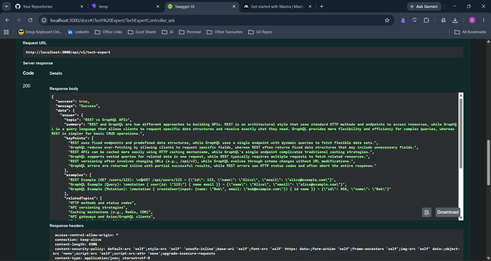

# PrepAI Backend Service

AI-powered interview preparation backend built with NestJS and Fastify. It integrates Mastra LLM agents with NVIDIA NIM to generate adaptive questions and evaluate user responses.



---

## Tech Stack & Tooling

- **Framework**: NestJS (v11) with Fastify adapter for high performance.
- **Language**: TypeScript (v6) in Strict mode.
- **ORM & Databases**:
  - Prisma (v6)
  - MongoDB (Users, UserSettings, Topics, Questions)
  - PostgreSQL (Theory and Coding sessions, questions, and answers)
- **AI Agent Orchestration**: Mastra (v1) with `@ai-sdk/openai` and configurable NVIDIA NIM/Groq providers.
- **Validation**: Zod (runtime validation) + class-validator/class-transformer.
- **Security**: Fastify Helmet (CSP, secure headers), Fastify CORS, and Fastify Rate Limit.
- **Authentication**: Clerk Node SDK.

---

## Development Setup

### Prerequisites

- Node.js v20+
- pnpm v9+

### Installation & Run

1. Install server dependencies:
   ```bash
   pnpm install
   ```
2. Start the dev server in watch mode:
   ```bash
   pnpm start:dev
   ```
   _Note: This runs Node natively with `--import @swc-node/register/esm-register` and `--env-file=../.env` to support TypeScript decorators and load environment keys early._

---

## API Routes

The API prefix is `/api/v1`, except for the unprefixed health probes. Successful responses use `{ success, message, data }`; errors use `{ success: false, message, statusCode, path, timestamp }`. Swagger is available at `http://localhost:3000/docs` in development.

### Implemented modules

- **Health:** `GET /health` is a simple process response; `GET /healthz` reports liveness; `GET /readyz` checks MongoDB, PostgreSQL, and Redis.
- **Tech expert:** `POST /api/v1/tech-expert` asks the public technology assistant.
- **Users:** `GET /api/v1/users/me`, settings read/update, setup completion, and an admin-only user lookup. Clerk login/logout is handled by Clerk; this API has no local login or logout endpoints.
- **Clerk webhook:** `POST /api/v1/webhooks/clerk` synchronizes user create/update/delete events. Profile and settings requests can also lazily synchronize a missing local user from Clerk.
- **Topics and questions:** authenticated reads with admin-only create/update/delete operations.
- **Theory:** session creation, question retrieval, answer submission, completion, history, weak-area analysis, and score trends. Access to another user's session returns 404. Question retrieval does not include the reference answer. If evaluation is unavailable, answer submission returns 503 and does not save a default score.
- **Coding:** problem listing/detail, session start, bounded Piston run/submit, owned session detail/completion, and paginated history. AI review and stats remain deferred. See the [coding API contract](../routes/coding-api-spec.md).
- **Background jobs:** Piston execution runs through BullMQ with bounded concurrency, retries, and retained failures. Host development starts the worker with the API; the full Podman profile runs a separate worker container. See [Background Jobs](../docs/architecture/background-jobs.md).

See the [route index](../routes.md) and the detailed [user](../routes/user-api-spec.md), [topic](../routes/topics-api-spec.md), [question](../routes/questions-api-spec.md), [webhook](../routes/webhooks-api-spec.md), and [theory](../routes/theory-api-spec.md) specifications.

### Coding backend setup

The coding module uses the PostgreSQL schema in `prisma/schema.postgresql.prisma` and the self-hosted Piston API v2. Validate and generate the client after schema changes:

```bash
pnpm prisma:validate:postgresql
pnpm prisma:generate
```

For a local development database, apply the additive schema change and seed one Two Sum problem:

```bash
pnpm prisma:push:postgresql
pnpm seed:coding:local
```

The seed is idempotent by slug and refuses any PostgreSQL hostname except `localhost`, `127.0.0.1`, or `::1`. Do not target shared or production data. The schema adds `CodingSession.problemIds String[] @default([])`.

Set `PISTON_URL=http://127.0.0.1:2000` for a host-run backend. The full Podman backend and worker use `PISTON_URL=http://host.containers.internal:2000`, since Piston runs on the host. Execution is on by default in development; production execution is disabled unless `PISTON_EXECUTION_ENABLED=true` is explicitly set after reviewing the Piston isolation setup. The current local Piston launcher uses a privileged container and must not be exposed publicly as-is.

For host development, `pnpm start:dev` runs the BullMQ worker in-process by default. For a producer-only API, set `JOBS_WORKER_ENABLED=false`; start a separate worker with `pnpm start:worker` and `JOBS_WORKER_ENABLED=true`. The full Podman profile configures these values automatically.

### Other planned modules

The coding/Piston API and its queued execution flow are implemented. AI code review, PDF ingestion and RAG, payments, email notifications, and a general study chatbot are not implemented in `server/src/modules/` yet. See the [backend implementation tracker](../docs/backend-status.md) for current completed and pending work, and [the architecture backlog](../docs/architecture/TODO.md) for design gaps. Do not implement local login/logout endpoints; authentication remains with Clerk.
